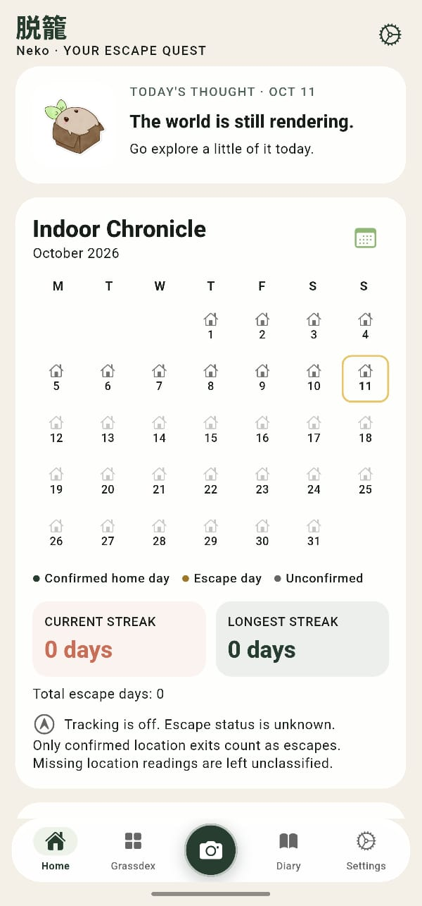
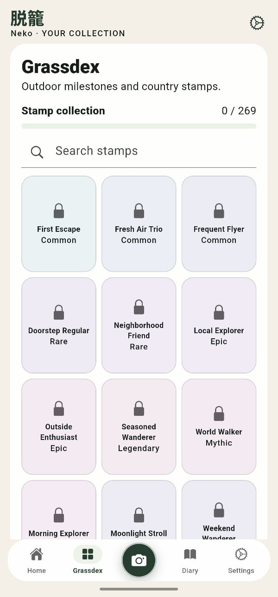
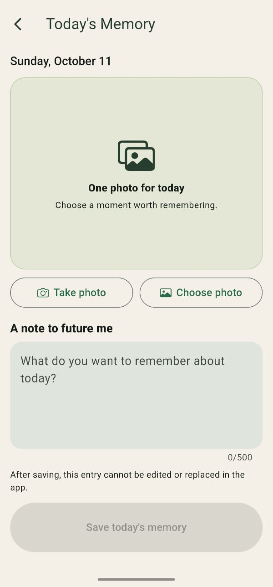
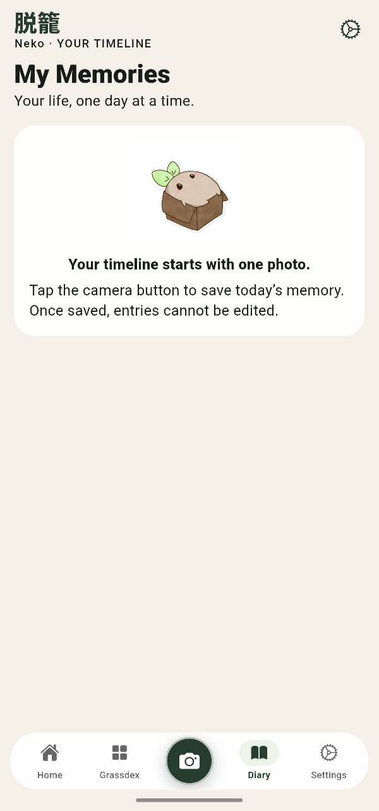
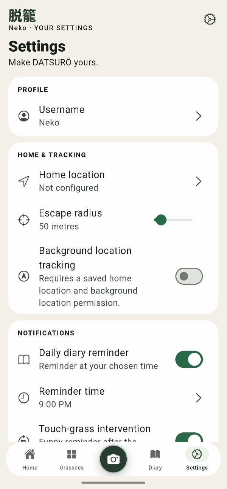

<div align="center">

  

  <h1>脱籠 — DATSURŌ</h1>

  <p><strong>Stay in. Step out. Collect life.</strong></p>

  <p>A cozy, slightly unhinged Android app for tracking indoor streaks, celebrating tiny escapes, collecting stamps, and remembering the days in between.</p>

  <p>
    
    
    
    
  </p>

  <p><em>Your room is a kingdom. The outside world is a side quest. 🌱</em></p>

</div>

---

## 🌱 What is DATSURŌ?

**DATSURŌ (脱籠)** is a local-first, game-inspired self-tracking app built with Flutter for **Android**. It turns everyday routines into a small, collectible adventure: track time at home, record detected outings, earn achievements, and preserve one little memory each day.

It is made for homebodies, reluctant adventurers, and anyone who wants a gentler nudge toward the outside world—with a little humor instead of guilt.

DATSURŌ is not a productivity drill sergeant. It is a tiny mascot cheering you on from a cardboard box.

> **The goal isn't to shame you for staying home. It's to make every small adventure feel worth remembering.**

## ✨ Highlights

| Feature | What it does |
| --- | --- |
| 🏠 **Indoor Chronicle** | Browse a calendar of recorded escapes, confirmed home days, and days with unknown status. |
| 🔥 **Streaks & stats** | See recorded indoor streaks, your longest streak, and total detected escape days. |
| 🌿 **Grassdex** | Collect achievements for outings, routines, diary milestones, and country discoveries. |
| 📸 **Daily Memory** | Save one photo and a note of up to 500 characters per day. |
| 📚 **Memory timeline** | Revisit your saved entries in date order. |
| 📍 **Home-radius tracking** | Set a home location and configure an escape radius from 30–150 metres. |
| 🏳️ **Country stamps** | Country or region stamps may be awarded when a country can be identified during an outing. |
| 🔔 **Local reminders** | Schedule a daily diary reminder and a configurable touch-grass intervention. |
| 🎨 **Personalization** | Choose a username, light or dark appearance, and one of four supported languages. |
| 📦 **Portable backups** | Export or import a ZIP backup of your profile and available diary photos. |

### 🧭 Explore the app

<p align="center">
  
  &nbsp;&nbsp;
  
  &nbsp;&nbsp;
  
</p>

<p align="center">
  
  &nbsp;&nbsp;
  
</p>

<p align="center"><em>Your home base, stamp collection, daily memories, diary, and settings.</em></p>

### 🏡 Home

Your little dashboard for daily life outside—or inside—the box.

- A daily encouragement message and mascot.
- An **Indoor Chronicle** calendar showing detected escape days, confirmed home days, unknown days, and today.
- Month and year navigation for browsing older calendar records.
- Current and longest recorded indoor streaks, plus total escape days.
- A tracking status indicator.
- Up to three recent achievements and a shortcut to the Grassdex.
- A reminder of whether today's memory has been saved.

**Note:** The Home Base graphic is an illustration, not a live map.

### 🌿 Grassdex

A collection book for the little things that count.

- **269 catalog entries** in the current source: 25 general achievement definitions plus 244 country or region entries.
- Search by stamp name, unlock condition, or country code.
- Open a stamp to read its description, condition, and collected status.
- Expand stamp history and filter it by date range.
- Earn achievements for escape milestones, outing patterns, diary milestones, tracking setup, and collection progress.

The catalog is not 269 individually illustrated stamp artworks. Country entries use flag imagery, while milestone entries use icons.

### 📸 Daily Memory

One day. One photo. A few words worth keeping.

- Take a photo or choose one from your gallery.
- Add a note of up to **500 characters**.
- Save the image in the app's private files and store the entry locally.
- Save **one entry per day**. Once saved, the entry is sealed and cannot be edited or replaced through the app's normal interface.

Diary activity does **not** count as an outdoor escape and does not change indoor streaks.

### 📖 Diary

A personal timeline of the days you chose to remember.

- Browse saved entries, newest first.
- Open an entry to view its photo, date, and note.
- See newly saved entries appear through store updates without needing to restart the app.

### ⚙️ Settings

Make the experience fit your life.

- Change your username.
- Set or update your home location.
- Adjust the escape radius from **30 to 150 metres**.
- Enable or disable automatic tracking.
- Configure the daily diary reminder and its time.
- Configure the touch-grass intervention and its threshold: **2, 3, 4, 5, or 7 days**.
- Switch between light and dark themes.
- Choose **English, Japanese, Korean, or Chinese**.
- Read the Privacy Policy and Terms of Use.
- Export or import a profile backup.
- Delete local profile data.

Some data-model fields, including quiet-hours and app-lock fields, do not currently have corresponding working Settings controls.

## 🛠️ Built with

- **Flutter & Dart** — UI toolkit, currently targeted at Android only.
- **Local device storage** — profile and app records are stored on the device in the current implementation.
- **Geolocator** — location readings and distance checks for home-radius tracking.
- **Local notifications** — operating-system-scheduled reminders.
- **Image picker & private files** — capture or select daily photos and keep copies in app storage.
- **ZIP backup & system share sheet** — export and import local profile data.

> **Platform scope:** This repository currently targets **Android only**. There is no iOS platform folder, and iOS compatibility or setup is not claimed.

## 🚀 Getting started

### Requirements

- Flutter SDK installed and available in your terminal.
- Android SDK and Android build tools configured.
- An Android device with Developer Options and USB debugging enabled, or an Android emulator.
- For a physical device, a USB cable that supports data and permission to authorize the connected computer.

Check your environment:

```bash
flutter doctor -v
flutter devices
```

### Run on Android

Open a terminal in the project root—the directory containing `pubspec.yaml`.

```bash
flutter pub get
flutter run
```

To target a specific connected Android device:

```bash
flutter devices
flutter run -d YOUR_ANDROID_DEVICE_ID
```

Replace `YOUR_ANDROID_DEVICE_ID` with the ID shown by `flutter devices`.

### If the Android folder is missing

If Flutter reports that `android/AndroidManifest.xml` cannot be found, generate the Android platform scaffolding **from the existing project root**:

```bash
flutter create --platforms=android .
flutter pub get
flutter run
```

The final `.` means “use the current directory.” Review any changes Flutter makes before committing them.

### Android device notes

Location tracking and notifications need real-device testing. Ensure location services are enabled and grant the permissions you want to use. Android battery management, permission settings, force-stopping the app, and operating-system scheduling can affect background behavior.

## 🔐 Privacy & data

DATSURŌ is designed to be **local-first**. The current implementation does not require an app account or an app-owned cloud backend.

- Profile information, stamps, diary records, and tracking history are stored locally in the current implementation.
- Diary photos are copied into the app's private files.
- The app records detected escape events rather than intentionally maintaining a continuous travel route.
- ZIP backups can contain profile data and available diary photos. Once exported, a backup is outside the app's control.
- Importing a backup replaces the current local profile after confirmation.
- Deleting local profile data does not delete backups previously exported elsewhere.
- The app does not claim app-level encryption.

**Local-first does not mean that every operation is guaranteed to remain on-device.** Android, a geocoding provider, the system share sheet, cloud backup settings, or other selected services may process or copy data under their own policies. Review the in-app Privacy Policy and your device's settings before enabling location access or sharing a backup.

## ⚠️ Current limitations

DATSURŌ is under active development. Please keep these limitations in mind:

- **Tracking is best-effort.** Location permissions, GPS accuracy, battery optimization, background limits, and force-stopping the app can interrupt tracking or cause missed exits.
- **An exit is a detected event, not proof of a complete outing.** Location readings can be delayed or inaccurate.
- **Unknown days should remain unknown.** Missing location data cannot reliably prove that a day was spent at home.
- **The Home Base graphic is illustrative.** It is not a live map.
- **Translations are incomplete in places.** Untranslated text may fall back to its original wording.
- **The stamp catalog is icon/flag-based.** The number of catalog entries should not be mistaken for the number of custom illustrated designs.
- **One memory per day is sealed after saving.** The current normal UI does not provide editing or replacement.
- **Notification delivery is not exact-time guaranteed.** Android may defer notifications.
- **No iOS target is included.** This repository currently supports Android only.
- **Physical-device verification is still important.** Successful dependency installation alone does not prove the app builds or that background features behave reliably.

## 🗺️ Roadmap ideas

Potential next steps as the project matures:

- [ ] Test background tracking across supported Android versions and device manufacturers.
- [ ] Improve tracking diagnostics and explain when location data is unavailable.
- [ ] Add automated tests for streak calculation, achievements, backup import/export, and data deletion.
- [ ] Audit first-run permission flows and notification scheduling.
- [ ] Verify backup compatibility and failure recovery.
- [ ] Complete translations and accessibility review.
- [ ] Add clear data-retention and backup guidance to the in-app privacy experience.

## 🤝 Contributing

Contributions, bug reports, and thoughtful feature ideas are welcome.

When reporting a tracking issue, include (where possible):

- Android version and device model.
- Whether location permission is granted.
- Whether location services and automatic tracking are enabled.
- Whether the app was open, in the background, or force-stopped.
- Relevant error output, with personal location details removed.

Please avoid sharing real coordinates, diary photos, or private backup files in public issues.

## 📄 Legal

DATSURŌ includes in-app Privacy Policy and Terms of Use content. Review those documents in the app before using location tracking or exporting personal data. This README is project documentation, not legal advice.

## 🌱 The tiny philosophy

You don't need to climb a mountain. You don't need to reinvent your life by Monday.

Sometimes the adventure is a walk around the block. Sometimes it's buying a drink from a shop you've never visited. Sometimes it's just opening the door.

**Go gently. Touch grass when you can. Keep the memories that matter.**

<div align="center">

  **脱籠 — DATSURŌ**

  <em>Escape the box. Collect the world, one little stamp at a time.</em>

</div>
